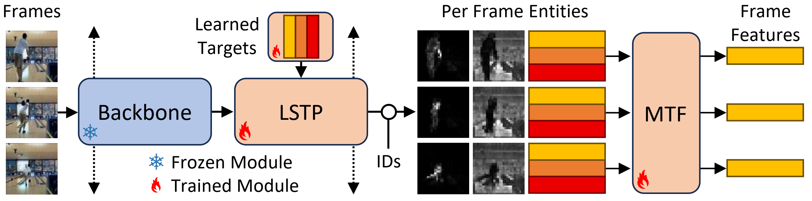

# Multi-entity Video Transformers for Fine-Grained Video Representation Learning (CVPRW 2025)



This is the official code release for MV-Former (Multi-entity Video Transformer) ([paper](https://openaccess.thecvf.com/content/CVPR2025W/FGVC/html/Walmer_Multi-entity_Video_Transformers_for_Fine-Grained_Video_Representation_Learning_CVPRW_2025_paper.html)) as published at the 12th Workshop on Fine-Grained Visual Categorization at CVPR 2025.

This code is forked from the Contrastive Action Representation Learning (CARL) codebase ([link](https://github.com/minghchen/CARL_code)).

# Environment Setup

```
# recommended conda pytorch setup for AWS:
conda create -y -n carl av pytorch=1.12.1 cudatoolkit=11.6 torchvision torchaudio \
--strict-channel-priority --override-channels \
-c https://aws-pytorch.s3.us-west-2.amazonaws.com \
-c pytorch \
-c nvidia \
-c conda-forge
conda activate carl

# repo requirements:
cd CARL_MVF
pip install -r requirements.txt
pip install protobuf==3.20.*
pip install --force-reinstall av
pip install timm==0.9.2
pip install decord
```

# Usage

First, download the necessary datasets by following the instructions in CARL_MVF/README.md.

To launch training, use the MV-Former config files provided in CARL_MVF/configs_mvf/

```bash
cd CARL_MVF
python -m torch.distributed.launch --nproc_per_node 1 train.py --workdir ~/datasets --cfg_file ./configs_mvf/penn_mvf.yml --logdir ~/penn_mvf
```

# Citation

Please cite as:

``` bibtex
@InProceedings{Walmer_2025_CVPR,
    author    = {Walmer, Matthew and Kanjirathinkal, Rose and Tai, Kai Sheng and Muzumdar, Keyur and Tian, Taipeng and Shrivastava, Abhinav},
    title     = {Multi-entity Video Transformers for Fine-Grained Video Representation Learning},
    booktitle = {Proceedings of the Computer Vision and Pattern Recognition Conference (CVPR) Workshops},
    month     = {June},
    year      = {2025},
    pages     = {2110-2120}
}
```

# License

The majority of MV-Former is licensed under CC-BY-NC, however portions of the project are available under separate license terms: https://github.com/minghchen/CARL_code is licensed under the MIT license.
